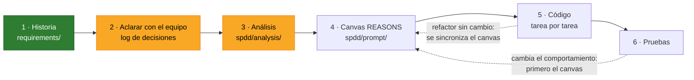
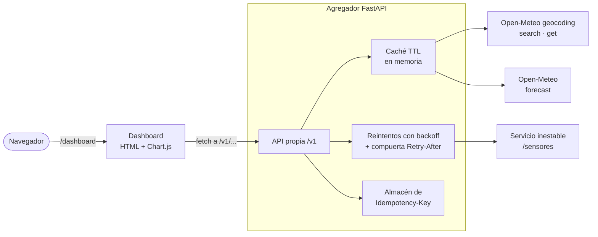
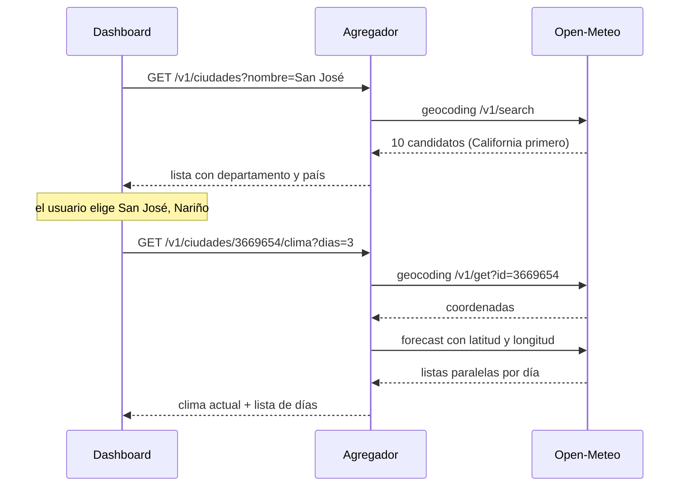
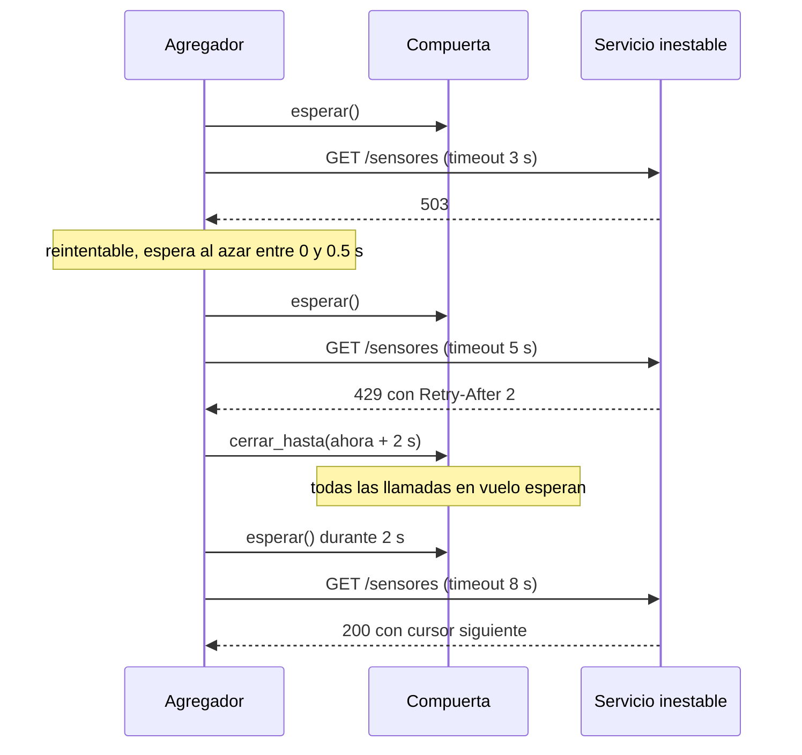

# Agregador resiliente de APIs

Parcial 2 de Sistemas Distribuidos (Escuela de Ingeniería de Sistemas e Informática,
UIS). Un servicio en FastAPI que consume **Open-Meteo** y un servicio de sensores que
falla a propósito, y expone una API propia que sigue respondiendo bien aunque sus
dependencias fallen. Encima va un dashboard.

El requerimiento se trabaja con **SPDD** (Structured Prompt-Driven Development): se
decide y se escribe la especificación antes de generar código, y cada decisión queda
registrada en este README.

## Estado

> **Fase actual: aclarar requerimientos (paso 2 de SPDD).** Hay 15 decisiones tomadas
> y 15 pendientes. **Todavía no hay código**: el equipo decidió cerrar las decisiones
> antes de desarrollar. Lo único ejecutable es `servicio_inestable.py`, del docente.



Verde: terminado. Amarillo: en curso. El análisis ya tiene la exploración hecha, pero
falta que el equipo lo revise.

## Integrantes y roles

| Integrante | Código | Rol |
|---|---|---|
| Javier Alexi Chacón Suárez | 2160044 | Pendiente ([P01](#decisiones-pendientes)) |
| *(compañera, nombre por completar)* | | Pendiente ([P01](#decisiones-pendientes)) |

## Qué vamos a construir

API propia (todo bajo `/v1`, salvo la salud):

| Método y ruta | Qué hace | Dependencia |
|---|---|---|
| `GET /v1/ciudades?nombre=&pais=` | Candidatos de una búsqueda, con departamento y país | Open-Meteo geocoding `search` |
| `GET /v1/ciudades/{id}/clima?dias=` | Clima actual y pronóstico por día de la ciudad elegida | Open-Meteo geocoding `get` → `forecast` |
| `GET /v1/sensores` | Todos los sensores con su lectura, tolerando fallos | Servicio inestable (paginación + lecturas) |
| `POST /v1/alertas` | Crea una alerta; idempotente con `Idempotency-Key` | Ninguna |
| `GET /salud` | Comprobación de vida del agregador | Ninguna |
| `GET /dashboard` | Dashboard estático (fase 2) | Nuestra propia API |



Cómo se encadenan las llamadas a Open-Meteo cuando el usuario busca una ciudad:



## Metodología: SPDD

SPDD es un método de Thoughtworks (publicado en el sitio de Martin Fowler en abril
de 2026) que trata los prompts como artefactos de ingeniería versionados junto al
código. El prompt estructurado se llama **canvas REASONS**:

| Letra | Sección | Pregunta que responde |
|---|---|---|
| R | Requirements | ¿Qué problema resolvemos y cuándo está terminado? |
| E | Entities | ¿Qué entidades hay y cómo se relacionan? |
| A | Approach | ¿Con qué estrategia lo resolvemos? |
| S | Structure | ¿Dónde encaja en el sistema? |
| O | Operations | ¿En qué pasos concretos y verificables se implementa? |
| N | Norms | ¿Qué convenciones aplican a todo? |
| S | Safeguards | ¿Qué no se puede romper nunca? |

Reglas que seguimos:

1. Primero la historia, después el análisis, después el canvas, y solo entonces el
   código, revisando en equipo entre cada paso.
2. **Cuando la realidad diverge, se corrige primero el canvas** y después el código.
   Un refactor que no cambia el comportamiento va al revés: código primero y luego se
   sincroniza el canvas.
3. SPDD no trae un log de decisiones propio. Lo agregamos aquí y cada decisión dice a
   qué sección del canvas alimenta, para que el canvas pueda citarla.

| Carpeta | Contenido |
|---|---|
| [`requirements/`](requirements/) | Historias y criterios de aceptación (paso 1) |
| [`spdd/analysis/`](spdd/analysis/) | Análisis: exploración de Open-Meteo y del servicio inestable (paso 3) |
| [`spdd/template/`](spdd/template/) | Plantilla del canvas REASONS |
| `spdd/prompt/` | Canvas REASONS (paso 4, siguiente) |

Los archivos siguen el patrón del artículo: `ID-AAAAMMDDhhmm-[Tipo]-descripcion.md`.

## Log de decisiones

Todas se tomaron el 2026-10-17. La ronda 0 es lo que el equipo trajo decidido; de
la 1 a la 3 se iteró con el agente antes de escribir nada.

| ID | Decisión | Alternativas descartadas | Por qué | REASONS | Ronda |
|---|---|---|---|---|---|
| D01 | API externa: **Open-Meteo** | Frankfurter, Nager.Date, PokeAPI, Open Library, datos.gov.co | Elección del equipo; permite encadenar geocodificación → pronóstico sin clave | R | 0 |
| D02 | Metodología **SPDD** con log de decisiones en este README | Desarrollo directo sin especificación | Elección del equipo; deja trazable por qué el código es como es | N | 0 |
| D03 | **Repo propio del grupo**; en el vault personal queda solo una nota con el enlace | Dentro del vault; vault ahora y repo después | Es trabajo en grupo y todos deben poder clonar y hacer push | S | 1 |
| D04 | Endpoints **separados** para clima y para sensores | Agregar un resumen de campus; un solo endpoint combinado | Cada parte se prueba y se explica sola; los fallos de un origen no contaminan al otro | S | 1 |
| D05 | Nombre ambiguo → **lista de candidatos con su país**, elegida en un buscador del dashboard | Tomar el primero con filtro de país; tomar solo el primero | «San José» da 10 resultados y el primero es California; el usuario debe ver y elegir | R | 1 |
| D06 | Log visualizado como **tabla + diagramas Mermaid** | Línea de tiempo; solo tabla | Se ve en GitHub y en Obsidian sin herramientas extra | N | 1 |
| D07 | Ciudades en dos endpoints: búsqueda `GET /v1/ciudades?nombre=&pais=` y clima por id `GET /v1/ciudades/{id}/clima` | `GET /v1/ciudades/{nombre}/clima` del catálogo | Derivada de D05: el id identifica una sola ciudad, y `get` + `forecast` son las dos llamadas distintas que exige el taller. *Propuesta en la ronda 2 sin objeciones; confirmar al revisar este PR.* | O | 2 |
| D08 | Dashboard en **HTML + JS (Chart.js)** servido por el mismo FastAPI | Streamlit; frontend aparte en React/Vite | Un solo proceso para el docente, sin CORS, dentro de las tecnologías del taller | S | 2 |
| D09 | **Backend primero** (partes A–D), dashboard después | En paralelo; dashboard desde el inicio | La rúbrica no da puntos por el dashboard; si falta tiempo, que falte lo que no suma | O | 2 |
| D10 | Dashboard con 4 vistas: **resiliencia, pronóstico, comparar ciudades, sensores y exterior vs interior** | Subconjuntos | El panel de resiliencia muestra en vivo lo que sí se califica; la relación exterior vs interior se arma en el dashboard llamando a los dos endpoints | R | 2 |
| D11 | Repo en `javierchacon262/agregador-resiliente`, **público** | Privado con colaboradores; organización del grupo | Elección del equipo. Riesgo aceptado: otros grupos pueden ver el código antes de la entrega | S | 2 |
| D12 | Reintentos **a mano**, con **cada función explicada en este log** ([detalle abajo](#d12-en-detalle-reintentos-función-por-función)) | tenacity; reintentos del transporte de httpx (solo reintentan errores de conexión, no 503 ni 429) | Es lo que más pesa en la evaluación (30 puntos) y cualquiera del grupo debe poder explicarlo | A | 3 |
| D13 | Timeout de lectura **adaptativo: 3 s → 5 s → 8 s** según el intento | 3 s fijo; 5–6 s fijo | El primer intento corta rápido las respuestas lentas y los siguientes toleran la latencia (4 s, o 5 s del docente) | A | 3 |
| D14 | Lecturas con **máximo 4 a la vez + compuerta compartida de Retry-After** | Secuencial; bajo demanda desde el navegador | El bloqueo por 429 es por IP: sin compuerta, las llamadas en vuelo aparecerían como «no respetó Retry-After» en el log del docente | A, S | 3 |
| D15 | Fallo parcial: **devolver siempre lo obtenido**, marcado como incompleto | Páginas todo o nada y lecturas parciales; todo o nada | Más disponibilidad para el dashboard. Ver el riesgo R1 | A | 3 |

### Riesgos y matices abiertos

| ID | Riesgo | Qué hacer |
|---|---|---|
| R1 | D15 choca con el enunciado cuando **no se obtiene nada**: exige «502 o 504 si la dependencia falla» y prohíbe el 500 genérico | Cerrar [P09](#decisiones-pendientes) (propuesta: con cero datos, 502/504). Además, una lista incompleta debe marcarse en las estadísticas del dashboard. |
| R2 | Con D13 el peor caso se alarga: 3 + 5 + 8 + 8 s de timeouts más las esperas pasa de 25 s | Cerrar [P08](#decisiones-pendientes): número máximo de intentos y plazo total por petición. |
| R3 | D11: el repo es público antes de la entrega | Aceptado por el equipo. |

### D12 en detalle: reintentos, función por función

> **Esto es diseño, todavía no hay código.** Cuando se implemente, esta sección se
> actualiza con lo que el código haga de verdad (regla 2 de SPDD). Los valores de base
> y tope son propuestas y serán configurables por variables de entorno.

Todo vive en un módulo `resiliencia.py`. Así se ve el comportamiento esperado en un
caso con 503, 429 y éxito:



**1. `es_reintentable(respuesta o error)` → sí/no**
- *Qué hace:* decide si vale la pena repetir. **Sí** con 503, 429 y timeout. **No**
  con 400, 404 y cualquier otro 4xx. Un 2xx no es fallo.
- *Por qué:* un 503, un 429 o un timeout son pasajeros. Un 400 o un 404 son
  definitivos: repetir da la misma respuesta y gasta peticiones de la dependencia.
- *Rúbrica:* «reintentos selectivos».

**2. `leer_retry_after(respuesta)` → segundos o nada**
- *Qué hace:* lee la cabecera `Retry-After` y la convierte en segundos. El servicio
  manda segundos enteros; el estándar HTTP (RFC 9110) también permite una fecha.
  Propuesta: aceptar las dos formas e ignorar valores inválidos.
- *Por qué:* es el servidor diciendo cuándo volver. Si volvemos antes, el servicio
  responde otro 429 y lo deja registrado.

**3. `calcular_espera(intento, retry_after)` → segundos**
- *Qué hace:* backoff exponencial con **jitter completo**:
  `espera = azar(0, mín(TOPE, BASE · 2^intento))`, y si vino Retry-After,
  `espera = máx(retry_after, espera)`.
- *Ejemplo* con BASE = 0,5 s y TOPE = 8 s: intento 0 → entre 0 y 0,5 s; intento 1 →
  0–1 s; intento 2 → 0–2 s; intento 3 → 0–4 s; de ahí en adelante, 0–8 s.
- *Por qué exponencial:* cada fallo sugiere que la dependencia está más cargada, y
  esperar más le da aire.
- *Por qué jitter:* si muchos clientes fallan a la vez y esperan lo mismo, vuelven
  todos juntos y la tumban otra vez. Es la pregunta b de la Parte D.
- *Por qué el máximo con Retry-After:* el azar puede dar menos de lo que pidió el
  servidor; nunca hay que volver antes.

**4. `timeout_para(intento)` → timeout de httpx**
- *Qué hace:* aplica D13. El timeout de lectura es 3 s en el primer intento, 5 s en el
  segundo y 8 s del tercero en adelante; el de conexión es fijo (propuesta: 2 s).
- *Por qué:* casi siempre conviene cortar rápido una respuesta lenta, porque el
  siguiente intento suele caer en una normal. Pero si ya fallamos, se da más margen
  para no seguir cortando una dependencia que simplemente está lenta.

**5. `CompuertaRetryAfter`** (una sola, compartida por todas las llamadas al servicio)
- `cerrar_hasta(instante)`: cuando llega un 429, guarda hasta cuándo no se puede
  llamar. Si ya había un cierre más largo, conserva el mayor.
- `esperar()`: se llama antes de cada petición; si la compuerta está cerrada, duerme
  hasta que abra.
- *Por qué:* el servicio bloquea **por IP**. Un solo 429 bloquea todas nuestras
  llamadas, no solo la que lo recibió. Sin compuerta, las otras llamadas en vuelo
  saldrían antes de tiempo y el log del docente las mostraría como «no respetó
  Retry-After» (D14).

**6. `llamar_con_reintentos(cliente, método, url, …)`** → respuesta, o error final

El ciclo que une todo; toda llamada saliente pasa por aquí:

```text
para cada intento desde 0 hasta MÁXIMO - 1:
    esperar la compuerta
    hacer la petición con timeout_para(intento)
    si salió bien (2xx)             → devolverla
    si no es reintentable (400/404) → devolverla sin reintentar
    si es 429                       → cerrar la compuerta con su Retry-After
    calcular la espera; si se pasa del plazo total → dejar de intentar
    registrar el intento (evidencia) y dormir la espera
si se agotaron los intentos → error de dependencia (502 o 504, P12)
```

- *Por qué en un solo lugar:* así las reglas no se repiten ni se contradicen entre
  endpoints.
- *Evidencia:* cada intento escribe una línea con la hora, el número de intento, la
  URL, el resultado, la espera elegida y si vino Retry-After (formato en P13).

**7. `recorrer_paginas()`** → lista de sensores y si quedó completa
- *Qué hace:* pide `/sensores`, luego `/sensores?cursor=siguiente`, hasta que
  `siguiente` sea `null`. Cada página pasa por `llamar_con_reintentos`.
- *Salvaguarda:* si un cursor se repite, corta, para que el recorrido termine siempre.
- *Si una página falla del todo:* devuelve lo obtenido con `completo: false` (D15).

**8. `leer_lecturas(ids)`** → lecturas, con `null` y motivo en las que fallaron
- *Qué hace:* pide las lecturas con un máximo de 4 a la vez (un semáforo de asyncio).
  Cada una pasa por la compuerta y por `llamar_con_reintentos`.
- *Por qué 4:* alcanza para que 23 lecturas no tarden un minuto, sin disparar decenas
  de peticiones a la vez contra un servicio que ya está fallando.

## Decisiones pendientes

Lo que falta decidir antes de escribir el canvas. Cada fila trae una propuesta para
arrancar la discusión; no es una decisión hasta que el equipo la confirme y pase a la
tabla de arriba.

| ID | Pregunta | Propuesta para discutir | Bloquea |
|---|---|---|---|
| P01 | Integrantes y rol de cada uno | Los cuatro roles del enunciado: servicio inestable, cliente de Open-Meteo, resiliencia, API propia + pruebas + README | README |
| P02 | TTL de la caché | Geocodificación 24 h (las ciudades no se mueven); pronóstico 15 min (Open-Meteo refresca cada 900 s); caché a mano con diccionario y reloj monotónico | HU2 |
| P03 | Cómo saltarse la caché para medir | Cabecera estándar `Cache-Control: no-cache` en la petición, y en la respuesta `X-Cache: HIT` o `MISS` | HU6 |
| P04 | Método de medición de latencia | Script que hace 20 peticiones en frío y 20 en caliente y reporta mediana y p95 | HU6 |
| P05 | Endpoint de métricas para el panel de resiliencia | `GET /v1/metricas` con reintentos por causa, aciertos de caché, latencias y estado de las dependencias | D10 |
| P06 | Qué es una «alerta» | Alerta de umbral: ciudad o sensor + variable + umbral (p. ej. «avisar si Bucaramanga pasa de 30 °C») | HU4 |
| P07 | Semántica de `Idempotency-Key` | Según el borrador IETF: sin clave → 400; misma clave y mismo cuerpo → la respuesta guardada; misma clave con otro cuerpo → 422; misma clave en curso → 409; claves en memoria por 24 h | HU4 |
| P08 | Máximo de intentos y plazo total (R2) | 3 intentos y plazo de 20 s por petición | D13 |
| P09 | Qué responder si «parcial siempre» no obtiene nada (R1) | 502 si la causa fue 503/429; 504 si fue timeout | D15 |
| P10 | Búsqueda sin coincidencias | 200 con lista vacía (una búsqueda vacía no es un recurso inexistente); el 404 queda para `/v1/ciudades/{id}` | HU1 |
| P11 | ¿Reintentos también hacia Open-Meteo y en errores de conexión? | Sí, con las mismas reglas y sin compuerta (Open-Meteo no manda Retry-After) | HU1, HU2 |
| P12 | 502 o 504 cuando se agotan los intentos | 504 si el último fallo fue timeout; 502 en los demás casos | Todas |
| P13 | Formato del log de evidencias | Una línea por intento con hora en ms, intento n/MÁXIMO, URL, resultado, espera y Retry-After, junto al log del servicio (no tenemos `tcpspy.py`) | Entrega |
| P14 | Herramienta SPDD | Plantillas propias de este repo (sin instalar nada) frente a la CLI comunitaria OpenSPDD | Canvas |
| P15 | ¿Hacemos la Parte E (consumo cruzado, +10)? | Decidir cuando el backend esté terminado | — |

### Supuestos (no se preguntaron; confirmar al revisar)

| ID | Supuesto |
|---|---|
| S1 | La API y el código van en español, como el enunciado (`/v1/ciudades`, `alertas`). |
| S2 | Compatibilidad con Python 3.11 o superior; la sala del docente usa Windows. |
| S3 | `servicio_inestable.py` no se modifica: es del docente y se configura por parámetros. |

## Cómo correr lo que ya existe

Por ahora solo el servicio inestable:

```bash
python -m venv venv
source venv/bin/activate          # Windows: venv\Scripts\activate
pip install fastapi uvicorn httpx
python servicio_inestable.py                                # puerto 9000
python servicio_inestable.py --tasa-fallos 0.4 --semilla 42 # fallos reproducibles
curl http://127.0.0.1:9000/salud
```

## Cómo continuar

El trabajo quedó a medias a propósito para que el equipo lo continúe. Las
instrucciones para cualquier persona o agente están en [`AGENTS.md`](AGENTS.md). En
resumen: revisar este PR, cerrar P01–P15 y registrar cada decisión en la tabla; luego
escribir el canvas REASONS en `spdd/prompt/` con la plantilla, y solo después de
revisarlo en equipo, generar código.

## Fuentes

- Wei Zhang (Thoughtworks), [Structured-Prompt-Driven Development (SPDD)](https://martinfowler.com/articles/structured-prompt-driven/), martinfowler.com, abril de 2026.
- [Open-Meteo: API de pronóstico](https://open-meteo.com/en/docs) y [API de geocodificación](https://open-meteo.com/en/docs/geocoding-api).
- IETF, [The Idempotency-Key HTTP Header Field](https://datatracker.ietf.org/doc/draft-ietf-httpapi-idempotency-key-header/) (borrador).
- Marc Brooker, [Exponential Backoff And Jitter](https://aws.amazon.com/blogs/architecture/exponential-backoff-and-jitter/), AWS Architecture Blog.
- [RFC 9110, sección 10.2.3: Retry-After](https://www.rfc-editor.org/rfc/rfc9110#name-retry-after).
- Vitillo, *Understanding Distributed Systems*: capítulo de APIs y capítulos de resiliencia.
