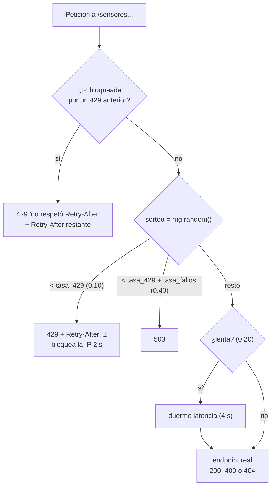

# AR-001 · Análisis: Open-Meteo y servicio inestable

| Campo | Valor |
|---|---|
| ID | AR-001 |
| Tipo | Análisis (paso 3 de SPDD) |
| Estado | Exploración hecha; **falta la revisión del equipo** antes de pasar al canvas |
| Fecha | 2026-10-17 |
| Historia | [AR-001 Story](../../requirements/AR-001-202610171311-[Story]-agregador-resiliente.md) |

Todo lo de este documento sale de peticiones reales con `curl` (17 de octubre de
2026), de leer `servicio_inestable.py` y, para la sección 3, de correrlo en un
contenedor. Nada está supuesto. Los hallazgos S1–S8 salen de leer el código; los
C1–C4, de ejecutarlo.

## Palabras clave del dominio

ciudad · candidato · geocodificación · pronóstico · clima actual · día · sensor ·
lectura · página · cursor · alerta · clave de idempotencia · reintento · espera ·
compuerta · caché · TTL · dependencia

## 1. Open-Meteo

Dos servicios distintos, ninguno pide clave:

| Uso | URL base | Endpoint |
|---|---|---|
| Buscar ciudad por nombre | `https://geocoding-api.open-meteo.com` | `/v1/search?name=&count=&language=es&countryCode=` |
| Traer ciudad por id | `https://geocoding-api.open-meteo.com` | `/v1/get?id=&language=es` |
| Pronóstico | `https://api.open-meteo.com` | `/v1/forecast?latitude=&longitude=&current=&daily=&timezone=auto&forecast_days=` |

### Lo que encontramos (y cómo afecta el diseño)

| # | Comportamiento real | Consecuencia para nosotros |
|---|---|---|
| E1 | Ciudad inexistente → **HTTP 200** con `{"generationtime_ms": …}` y **sin** el campo `results` | El modelo debe tratar `results` como opcional. Nosotros decidimos qué responder (P10). |
| E2 | Nombre de 1 letra → 200 vacío | Validar `min_length=2` y responder 422 sin llamar a Open-Meteo. |
| E3 | Nombres ambiguos: «Bucaramanga» trae 3 (Santander, Cundinamarca, Córdoba); «San José» trae 10 y el primero es California | Origen de D05: devolver candidatos con país y departamento. |
| E4 | `countryCode=CO` filtra bien (San José → solo Colombia) | Parámetro `pais` opcional en la búsqueda. |
| E5 | `get?id=3688465` devuelve la misma ficha que la búsqueda | Permite `GET /v1/ciudades/{id}/clima` (D07) con dos llamadas distintas. |
| E6 | `get?id` inexistente → **HTTP 400** `{"error":true,"reason":"Location ID not found."}` | **No** reintentar y traducir a **404**. Ojo: no todo 400 de Open-Meteo es «no existe». |
| E7 | El pronóstico diario viene en **listas paralelas** (`daily.time[]`, `daily.temperature_2m_max[]`, …) | Hay que juntarlas por día; validar que tengan el mismo largo. |
| E8 | Errores de validación → 400 con `{"error": true, "reason": "…"}` (latitud fuera de rango, variable inexistente, días > 16) | Validar nosotros primero (422) para no gastar llamadas. |
| E9 | `forecast_days` permite 0–16. Con 20 el mensaje dice «Given 16» (bug de ellos) | No confiar en el texto de `reason`; validar el rango nosotros. |
| E10 | **No** manda cabeceras de caché ni de límite de peticiones | El TTL lo fijamos nosotros (P02). |
| E11 | `current.interval` = 900 s: el dato actual se refresca cada 15 min | Un TTL de pronóstico por encima de 15 min entrega datos viejos. |
| E12 | `weather_code` es código WMO (p. ej. 51 = llovizna) | Para el dashboard hace falta una tabla de códigos → texto. |
| E13 | Toda la sala sale por la misma IP pública (dice el enunciado) | La caché reduce la carga compartida; los límites de Open-Meteo se reparten entre grupos. |

### Muestra real (Bucaramanga, recortada)

```json
{
  "timezone": "America/Bogota",
  "current": {"time": "2026-10-17T12:15", "interval": 900,
              "temperature_2m": 26.9, "relative_humidity_2m": 61,
              "weather_code": 51, "wind_speed_10m": 6.7},
  "daily": {"time": ["2026-10-17", "2026-10-18", "2026-10-19"],
            "temperature_2m_max": [27.4, 26.1, 27.7],
            "temperature_2m_min": [20.5, 20.3, 20.1],
            "precipitation_probability_max": [95, 88, 76]}
}
```

## 2. Servicio inestable (`servicio_inestable.py`)

### Endpoints

| Ruta | Falla a propósito | Notas |
|---|---|---|
| `GET /salud`, `GET /config` | No | El middleware solo inyecta fallos en rutas que empiezan por `/sensores`. |
| `GET /sensores?cursor=` | Sí | 23 sensores, 5 por página → 5 páginas; `siguiente` es `null` en la última. Cursor opaco (base64 de `o:{desplazamiento}`); cursor inválido → 400. |
| `GET /sensores/{id}/lectura` | Sí | Sensor inexistente → 404. |

### Orden en que decide cada petición a `/sensores…`



### Lo que encontramos al leer el código

| # | Hallazgo | Consecuencia para nosotros |
|---|---|---|
| S1 | El bloqueo tras un 429 es **por IP**, y se revisa **antes** del sorteo | Cualquier llamada que salga antes de vencer el Retry-After queda en el log como «no respetó». Con concurrencia, todas las llamadas en vuelo deben esperar juntas: origen de la compuerta (D14). |
| S2 | El sorteo de fallos ocurre **antes** de validar el sensor | Un sensor inexistente puede responder 503/429 antes de dar su 404. Reintentar el 503 está bien; el 404 que llega después se respeta. |
| S3 | La lentitud duerme **antes** de responder; si nosotros cortamos por timeout, el servidor igual termina y registra el código después | En la evidencia puede aparecer «lenta» y luego «200» aunque nosotros ya hayamos reintentado. Hay que explicarlo al presentar los logs. |
| S4 | Con valores por defecto: 10 % de 429, 30 % de 503 y 60 % de éxito (de esos, 20 % lentos) | Sin contar timeouts, cada llamada necesita en promedio 1/0,6 ≈ 1,7 intentos. `GET /v1/sensores` hace al menos 5 páginas + 23 lecturas = 28 llamadas, unos 47 intentos en promedio. Si el primer timeout (3 s, D13) corta las lentas, el éxito del primer intento baja a 0,6 × 0,8 = 48 %. |
| S5 | `--semilla` fija la **secuencia** de sorteos de todo el servicio, no la de cada petición | Con concurrencia, el orden de llegada cambia quién recibe cada fallo; la reproducibilidad es parcial. |
| S6 | Los valores de las lecturas usan `random.uniform` global, no la semilla | Los valores no se repiten entre corridas aunque se use `--semilla`. |
| S7 | El docente puede arrancarlo con otros parámetros (el ejemplo del enunciado usa `--latencia 5`) | Timeouts, intentos y esperas deben ser configurables por variables de entorno. |
| S8 | El servicio imprime una línea por petición con hora en milisegundos (`flush=True`) | Ese log sirve como evidencia de intentos, esperas y respeto de Retry-After. |

## 3. El servicio inestable dentro de Docker (D16)

Verificado el 2026-10-17 corriendo `servicio_inestable.py` sin modificar en un
contenedor `python:3.12-slim` (Docker 29.7.2), con una instancia en el host por
defecto y otra con `--host 0.0.0.0`.

| # | Hallazgo | Consecuencia para nosotros |
|---|---|---|
| C1 | Con el host por defecto (`127.0.0.1`) el servicio responde **solo desde dentro** del contenedor; desde la máquina, `curl` falla con la conexión cortada (exit 56) | En Compose hay que arrancarlo con `--host 0.0.0.0`. Es un parámetro, así que no se modifica el archivo (S3). |
| C2 | `docker logs` sale **vacío** al arrancar: los dos `print` del inicio no usan `flush` y quedan en el buffer de Python. Las líneas por petición sí salen, porque usan `flush=True` | `PYTHONUNBUFFERED=1` en los contenedores (P17), o el mensaje de arranque no aparece en la evidencia. |
| C3 | Las peticiones que llegan a través de Docker aparecen con **una sola IP** (`172.17.0.1`, el gateway de Docker) | El bloqueo por IP tras un 429 sigue aplicando igual: la compuerta de D14 es necesaria también con Docker. |
| C4 | `docker stop` tarda 0,5 s y sale con código 0: uvicorn maneja SIGTERM aunque sea el PID 1 | No se repite el problema del taller de Docker, donde `http.server` ignoraba SIGTERM y Docker lo mataba a los 10 s. Hay que comprobarlo también con el agregador. |

## 4. Casos borde que van al canvas (Safeguards)

1. Nunca reintentar 400 ni 404, ni siquiera los 400 de Open-Meteo.
2. Nunca llamar al servicio inestable antes de que venza un Retry-After recibido.
3. Nunca devolver un 500 genérico: errores de las dependencias → 502 o 504.
4. Validar los parámetros propios (422) antes de gastar una llamada externa.
5. Toda llamada saliente lleva un timeout explícito.
6. Un recorrido de paginación termina siempre (cursor `null` o error), sin bucles.
7. Todo lo que se ejecute corre en contenedores (D16), y el agregador termina limpio
   con `docker stop` (C4).

## 5. Preguntas abiertas que salieron del análisis

Están en la tabla de [decisiones pendientes](../../README.md#decisiones-pendientes)
del README: P02 (TTL), P08 (intentos y plazo total), P09 (parcial sin datos),
P10 (búsqueda vacía), P11 (reintentos hacia Open-Meteo), P12 (502 vs 504) y
P16–P21 (cómo se arma Docker).
